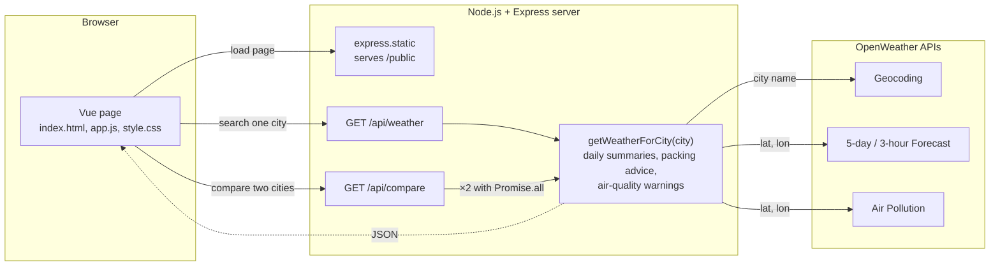
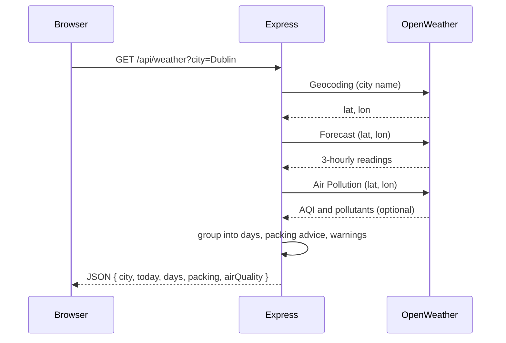

# Weather Planner

CSU44000 Internet Applications – Assignment 1
Liliana Berenguer Jin

---

## 1. Requirements

Weather Planner is a small reactive Internet Application that takes a destination city and tells the traveller what to pack. The client runs in the browser using Vue 3. It talks to a Node.js / Express server, which does the actual work: it calls OpenWeather's APIs, reduces what comes back into a short summary, and returns that as one JSON object for the client to display.

Before writing any code, I listed the core requirements from the assignment and matched each one to the OpenWeather API that could provide the data. In retrospect this was a really useful starting point for deciding how to structure the server side. Table 1 shows more or less what I concluded from it.

**Table 1 – Requirements and the OpenWeather API used for each**

| Requirement | OpenWeather API | What it provides |
|---|---|---|
| Turn the city name into a location | Geocoding (`/geo/1.0/direct`) | Latitude and longitude |
| Three-day table of temperature, wind speed and rainfall | 5-day / 3-hour Forecast (`/data/2.5/forecast`) | Around 40 readings at three-hour intervals |
| Umbrella if rain is forecast; Cold / Mild / Hot packing advice (below 8 °C, 8–24 °C, above 24 °C) | Forecast (same response) | Rain and temperature per reading |
| Warning for each pollutant above the "Good" level, with its level and health risk | Air Pollution (`/data/2.5/air_pollution`) | AQI (1–5) and the concentration of each pollutant |
| Compare two cities side by side (extra feature) | All of the above, twice | Two summaries plus a verdict |

The APIs themselves also set the order of the requests: the Forecast and Air Pollution APIs take coordinates rather than a city name, so Geocoding always has to go first.

---

## 2. System architecture

**Figure 1 – System architecture.** The browser loads the page from Express and then sends it a city through one of the two routes. Express calls `getWeatherForCity`, which asks OpenWeather for the location, the forecast and the air quality, builds the summary, and returns it to the browser as JSON. For a comparison the same function runs twice.

Some main observations:

- The route handlers only deal with HTTP. They read and validate the query string and turn errors into status codes. Everything else happens in `getWeatherForCity`, which fetches and processes the data for one city. Both routes call it, so when I added the comparison feature I did not have to duplicate the lookup. The helpers below it (`makeDailySummaries`, `makePackingAdvice`, `makeAirQualitySummary`) contain the rules and have no idea they are inside a web server.
- The server is stateless. Both routes are plain `GET` requests, there are no sessions and nothing is stored between calls, so the same request always gives the same answer. This was the simplest option and it also made the server easy to test on its own, by opening the route in the browser with a city in the URL.
- The client follows the MVC paradigm: the JSON from the server is the model, the HTML template is the view, and the Vue instance holding the data and methods is the controller. There is no manual DOM manipulation: the template describes what each state should look like and Vue updates the DOM when the data changes.
- I kept dependencies to a minimum. Node 22 already has `fetch` and can load `.env` itself, and Vue comes from a CDN, so the project only installs Express and nothing needs to be built before running it.

---

## 3. Implementation

### 3.1 Server side

I found myself building the server in three iterations, each one answering a different question: first, can I get anything out of OpenWeather at all; then, what do I do with what comes back; and finally, what goes wrong once I try it with real cities.

**Iteration 1:** the first version just called the Geocoding and Forecast APIs and passed the response straight through, with nothing processed and no error handling. What I got out of this:

- Understanding the Forecast response. OpenWeather does not return "days"; it returns a `list` of about forty entries, one every three hours, each with its own temperature, wind and rain values, so to show three days I would have to group those entries myself. The timestamps are in UTC and the response includes a `city.timezone` offset, which mattered later.
- The shape of the route handler. The Forecast call cannot start until Geocoding has returned the coordinates, so the handler is an `async` function with two `await`s in a row. While it waits on OpenWeather the event loop is free to serve other requests, which is why this does not block the server even though JavaScript runs on a single thread.

**Iteration 2:** this is where the logic of the app got built on top of those responses:

- The three-hourly entries are grouped by date, and for each day the server computes the min, max and average temperature, the average wind speed, the total rainfall and whether rain is expected.
- The Cold / Mild / Hot thresholds from the brief are applied to each day's average, and the advice becomes "pack layers" if the days fall into different categories. The umbrella flag, on the other hand, is set if any day expects rain.
- The Air Pollution API call was added. Each pollutant is compared with the upper limit of OpenWeather's "Good" band, and anything above it is reported with its band and a short health risk.
- Error handling. The route checks the city before doing anything, and every failure ends in an HTTP status code and a message the client can show (Table 2). The `fetch` calls are wrapped in a small `getOpenWeatherJson` helper that throws with a status attached, so the route does not have to check every response by hand.

| Status | Condition |
|---|---|
| 200 (OK) | Success: `city`, `today`, `days[3]`, `packing`, `airQuality` |
| 400 (Bad Request) | City missing or over 100 characters |
| 404 (Not Found) | Geocoding returns no match |
| 500 (Internal Server Error) | API key missing from `.env` |
| 502 (Bad Gateway) | OpenWeather unreachable, returned an error, or returned too little data |

**Table 2 – Status codes returned by `GET /api/weather`.** The client only checks `response.ok`, so the exact code matters less than the message that comes with it; the codes are there so the API behaves sensibly for anything other than this client, including a plain browser tab.

**Iteration 3:** once the logic was in place I tried the app with more cities and at different times of day, and three things needed fixing:

- Days were grouped on UTC dates, which gave the wrong first day for cities far from Greenwich. Entries are now shifted by `city.timezone` first, and the current partial day is shown separately as "today".
- A failure in the Air Pollution request used to take the whole response down. It now has its own `try/catch`, so the forecast still renders if air quality is unavailable.
- The route handler had grown into one long `app.get`. The lookup moved into its own function, `getWeatherForCity`, which is what later made the comparison feature cheap to add.

### 3.2 Sequence of a search

Figure 2 shows what the final server does for one search. The browser sends the city to `/api/weather`. The server calls Geocoding to turn the name into coordinates, then Forecast with those coordinates for the three-hourly readings, then Air Pollution with the same coordinates for the current air quality. The three calls run one after the other because each needs the result of the previous one, and the air-quality call is the only one allowed to fail. Once the data is in, the server groups the readings into days, works out the packing advice and the pollutant warnings, and returns everything as a single JSON object. The browser never sees the intermediate responses, only the final one.

**Figure 2 – One search handled by the final server**

### 3.3 Client side

The client is a single Vue instance. I began with a skeleton: an input, a button and the raw JSON printed on screen, and then built the real interface on top of it. The main idea was that the page has a small amount of state (the city typed in, whether a request is running, the result, and any error) and the HTML template describes what to show for each of those. When the server replies, the state changes and Vue updates the DOM; nothing is updated by hand.

Within that, the template uses the usual Vue directives: `v-model` for the input, `v-if` to switch between the loading, error and result views, `v-for` for the forecast rows and pollutant warnings, and `:class` for the Cold / Mild / Hot colours. The methods are the two `fetch` calls (search and compare), which share one helper for reading the response and raising the server's error message, plus a few formatters for dates and numbers.

For the layout, today's summary sits on the left and the forecast table, packing advice and air quality on the right, with an icon for each day's conditions.

**Figure 3 – Result view for Dublin** *(screenshot)*

### 3.4 Extra feature: comparing two destinations

Once a city is loaded, the user can enter a second one and see both forecasts side by side with a short verdict: which has the better weather, which needs an umbrella, and which has worse air. I chose this feature because deciding between places is the real reason someone would open the app, and it required non-trivial work on both sides.

- **Server.** A second route, `GET /api/compare?cities=A&cities=B`. It accepts repeated parameters so that names with country codes ("Dublin, IE") are not split on the comma. It runs `getWeatherForCity` for both cities with `Promise.all`, so the two lookups proceed concurrently rather than one after the other. `makeCityComparison` then ranks them: fewer rainy days wins, more Mild days breaks a tie, and the worse AQI is flagged. The verdict text is composed on the server so the wording stays consistent.
- **Client.** A second form bound to `comparisonCity`, with its own `comparing` and `comparisonError` state so it never interferes with the main search, and a `v-for` over the two results rendering a card each, with the winner highlighted through `:class`.

**Figure 4 – Dublin compared with Lisbon** *(screenshot)*

---

## 4. Testing, limitations and future work

I tested manually against a checklist: a known city (Dublin, IE), an ambiguous one (Paris vs Paris, US), a made-up city, a missing API key, the Air Pollution URL deliberately broken, Tokyo for the local-date grouping, and a comparison with one invalid city to confirm the 404 is reported cleanly. Because the API is stateless, I could also exercise the server on its own from the address bar.

Known limitations: only the first Geocoding match is used, air quality is the current reading rather than a forecast, and the comparison ranking is a simple heuristic. The natural next steps are deploying the server on AWS so the app no longer has to run locally, and caching OpenWeather responses for a few minutes, since a comparison currently costs six upstream calls.

What I mainly took from this assignment is that most of the work in an application like this happens on the server, reshaping someone else's data into exactly what the page needs, and that the client becomes much simpler once the UI is a function of its state.

---

**Appendix A – Source code** · **Appendix B – Academic integrity declaration**
