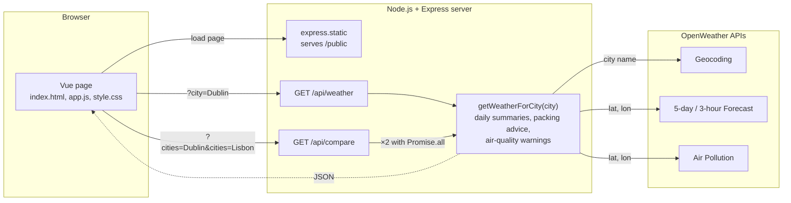
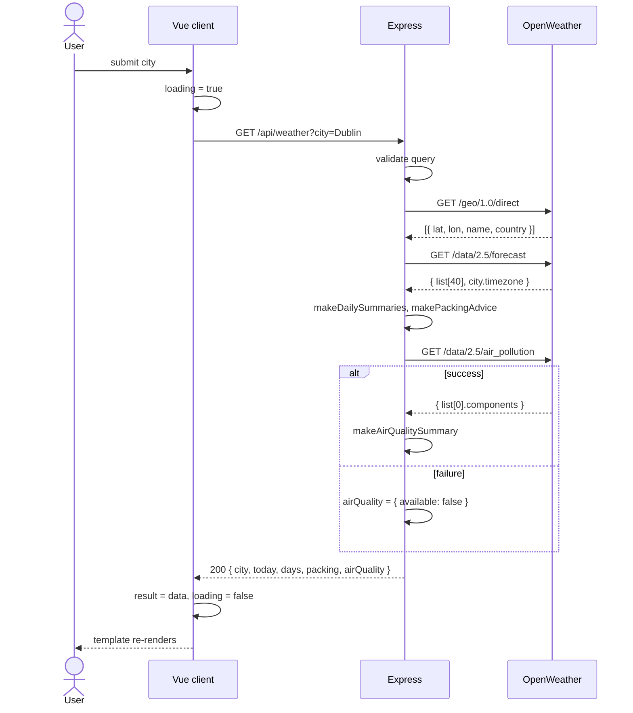

# Weather Planner

CSU44000 Internet Applications – Assignment 1
Liliana Berenguer Jin

---

## 1. Requirements

Weather Planner is a small reactive Internet Application that takes a destination city and tells the traveller what to pack. The client runs in the browser using Vue 3. It talks to a Node.js / Express server, which does the actual work: it calls OpenWeather, reduces what comes back into a short summary, and returns that as one JSON object for the page to display. The calls to OpenWeather have to live on the server because of the browser's same-origin policy, and it keeps the API key out of the client anyway.

Before writing any code, I listed the core requirements from the assignment and matched each one to the OpenWeather API that could provide the data. This gave me a starting point for how to structure the server and, more importantly, what the client would never need to know about. Table 1 is what I ended up with.

**Table 1 – Requirements and the OpenWeather API used for each**

| Requirement | OpenWeather API | What it provides |
|---|---|---|
| Turn the city name into a location | Geocoding (`/geo/1.0/direct`) | Latitude and longitude |
| Three-day table of temperature, wind speed and rainfall | 5-day / 3-hour Forecast (`/data/2.5/forecast`) | Around 40 readings at three-hour intervals |
| Umbrella if rain is forecast; Cold / Mild / Hot packing advice (below 8 °C, 8–24 °C, above 24 °C) | Forecast (same response) | Rain and temperature per reading |
| Warning for each pollutant above the "Good" level, with its level and health risk | Air Pollution (`/data/2.5/air_pollution`) | AQI (1–5) and the concentration of each pollutant |
| Compare two cities side by side (extra feature) | All of the above, twice | Two summaries plus a verdict |

One thing the table made obvious is the order of the requests: Geocoding has to go first, since the other two APIs want coordinates rather than a name.

---

## 2. System architecture

**Figure 1 – System architecture.** The browser loads the page from Express and then sends it a city through one of the two routes. Express calls `getWeatherForCity`, which asks OpenWeather for the location, the forecast and the air quality, builds the summary, and returns it to the browser as JSON. For a comparison the same function runs twice.

Some main observations:

- The route handlers are kept short on purpose. All they do is read the query string, check it, and return a status code if something is wrong. The real work is in a separate function, `getWeatherForCity`, which makes the OpenWeather calls and builds the result for one city. Having it separate meant both routes could share it, so the comparison feature did not need its own copy of the lookup. The helpers it uses (`makeDailySummaries`, `makePackingAdvice`, `makeAirQualitySummary`) only contain the rules and do not know anything about HTTP.
- Both routes are `GET` and the server keeps no state at all: no sessions, no database. Repeating a request is safe and gives the same answer. I went with this because it was the simplest option, and it turned out to be handy for testing, since I could call the API directly from the address bar.
- The client follows the MVC paradigm. The JSON from the server is the model, the HTML template is the view, and the Vue instance holding the data and methods is the controller. There is no manual DOM manipulation: the template describes what each state should look like and Vue updates the DOM when the data changes.
- I kept dependencies to a minimum. Node 22 already has `fetch` and can load `.env` itself, and Vue comes from a CDN, so the project only installs Express and nothing needs to be built before running it.

---

## 3. Design process

I built the server in three iterations, which I found useful because it separated three different questions: can I retrieve data from OpenWeather at all, what should be done with it, and what breaks once real cities are involved. The client took two.

### 3.1 Server

**Iteration 1 – retrieving the data.** The first version only fetched and returned. It reads the city from the query string, calls Geocoding, takes the first match, calls Forecast with its `lat` and `lon`, and returns the raw readings. There was no validation and no error handling, around eighty lines in total. The goal of this step was twofold:

- Get `async/await` working with two calls that depend on each other. `fetch` runs outside the JavaScript engine as a Web API, and `await` hands control back to the event loop until the reply arrives. Node is single-threaded, but the server is never blocked while waiting on OpenWeather.
- See what the data actually looks like. This is where I noticed that timestamps are in UTC, that `rain["3h"]` is only present when it rained, and that the forecast includes a `city.timezone` offset.

**Iteration 2 – processing the data.** This iteration delivered the core features:

- Readings are grouped into days, and for each day the server computes min, max and average temperature, average wind speed, total rainfall and whether rain is expected.
- The Cold / Mild / Hot thresholds from the brief are applied to each day's average. If the three days fall into different categories the advice becomes "pack layers". The umbrella flag is set if any day expects rain.
- The Air Pollution call was added. Each pollutant is compared with the upper limit of OpenWeather's "Good" band, and anything above it is reported with its band and a short health risk.
- Input validation and proper HTTP status codes (Table 2). A small `getOpenWeatherJson` helper wraps `fetch` and throws an error carrying a status when the network fails or OpenWeather replies with an error, which keeps the route handler readable.

**Table 2 – Responses from `GET /api/weather`**

| Status | Condition |
|---|---|
| 200 | Success: `city`, `today`, `days[3]`, `packing`, `airQuality` |
| 400 | City missing or over 100 characters |
| 404 | Geocoding returns no match |
| 500 | API key missing from `.env` |
| 502 | OpenWeather unreachable, returned an error, or returned too little data |

**Iteration 3 – refining.** Testing with more cities and at different times of day exposed three problems, each of which changed the code:

- *The first day was wrong.* Searching in the evening produced a "day" with one or two readings, and for Tokyo the grouping landed on the wrong date because I was grouping by UTC. Each reading is now shifted by `city.timezone` before its date is taken, the current partial day is shown separately as "today", and the table shows the next three full local days.
- *One failing API took down the page.* When Air Pollution returned an error, the forecast was lost as well. That call now sits in its own `try/catch` and returns `{ available: false }` on failure, so the forecast still renders with a note.
- *The route handler had grown too large.* Everything lived inside one `app.get`. I moved the lookup into `getWeatherForCity(city)`, which throws errors tagged with a status and a message that the route simply passes on. This refactor is what made the comparison feature cheap to add.

**Figure 2 – Sequence of one search against the final server**

### 3.2 Client

**Iteration 1 – rendering the JSON.** One input, one button and the raw response in a `<pre>` element: `v-model` on the input, a method calling `fetch`, and `{{ result }}` in the template. Its only purpose was to prove the round trip.

**Iteration 2 – a state-driven interface.** The final client keeps that skeleton, but the whole page is derived from a handful of reactive variables: `city`, `loading`, `result` and `error`. The template declares what each state looks like and Vue updates the DOM when the variables change; I never manipulate the DOM directly. Compared with the `XMLHttpRequest` approach of locating an element and setting its `innerHTML`, it removes an entire category of bugs where the page and the data disagree.

**Table 3 – Vue features used in the client**

| Feature | Used for |
|---|---|
| `v-model.trim` | Two-way binding on both city inputs |
| `@submit.prevent` | Running the search without a page reload |
| `:disabled` | Blocking buttons while a request is in flight |
| `v-if` / `v-else-if` / `v-else` | Loading, error, empty and result panels |
| `v-for` with `:key` | Forecast rows, pollutant warnings, comparison cards |
| `:class` | Colour badges for Cold / Mild / Hot, umbrella, AQI, "better forecast" |
| `{{ }}` | All text output |
| `computed` | `cityLabel` from city, state and country |
| `methods` | Fetch calls and formatting helpers |

`searchWeather` calls `fetch` inside `try / catch / finally`, so `loading` is always reset. A shared `readJsonResponse` helper parses the reply and throws the server's error message when the status is not OK, so the search and the comparison handle failures identically, each showing the message with a Retry button.

For the layout, today's summary sits on the left and the forecast table, packing advice and air quality on the right. Weather icons come from an SVG sprite mapped from OpenWeather's icon codes, and on narrow screens the table collapses into stacked cards.

**Figure 3 – Result view for Dublin** *(screenshot)*

### 3.3 Iteration 3 – comparing two destinations

Once a city is loaded, the user can enter a second one and see both forecasts side by side with a short verdict: which has the better weather, which needs an umbrella, and which has worse air. I chose this feature because deciding between places is the real reason someone would open the app, and it required non-trivial work on both sides.

- **Server.** A second route, `GET /api/compare?cities=A&cities=B`. It accepts repeated parameters so that names with country codes ("Dublin, IE") are not split on the comma. It runs `getWeatherForCity` for both cities with `Promise.all`, so the two lookups proceed concurrently rather than one after the other. `makeCityComparison` then ranks them: fewer rainy days wins, more Mild days breaks a tie, and the worse AQI is flagged. The verdict text is composed on the server so the wording stays consistent.
- **Client.** A second form bound to `comparisonCity`, with its own `comparing` and `comparisonError` state so it never interferes with the main search, and a `v-for` over the two results rendering a card each, with the winner highlighted through `:class`.

**Figure 4 – Dublin compared with Lisbon** *(screenshot)*

---

## 4. Testing, limitations and future work

I tested manually against a checklist: a known city (Dublin, IE), an ambiguous one (Paris vs Paris, US), a made-up city, a missing API key, the Air Pollution URL deliberately broken, Tokyo for the local-date grouping, and a comparison with one invalid city to confirm the 404 is reported cleanly. Because the API is stateless, I could also exercise the server on its own from the address bar.

Known limitations: only the first Geocoding match is used, air quality is the current reading rather than a forecast, and the comparison ranking is a simple heuristic. The natural next steps are deploying the server on AWS so the app no longer has to run locally, and caching OpenWeather responses for a few minutes, since a comparison currently costs six upstream calls.

What I mainly took from this assignment is that most of the work in an application like this happens on the server, reshaping someone else's data into exactly what the page needs, and that the client becomes much simpler once the UI is a function of its state.

---

**Appendix A – Source code** · **Appendix B – Academic integrity declaration**
