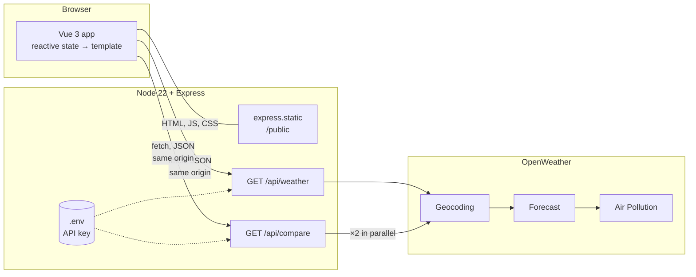
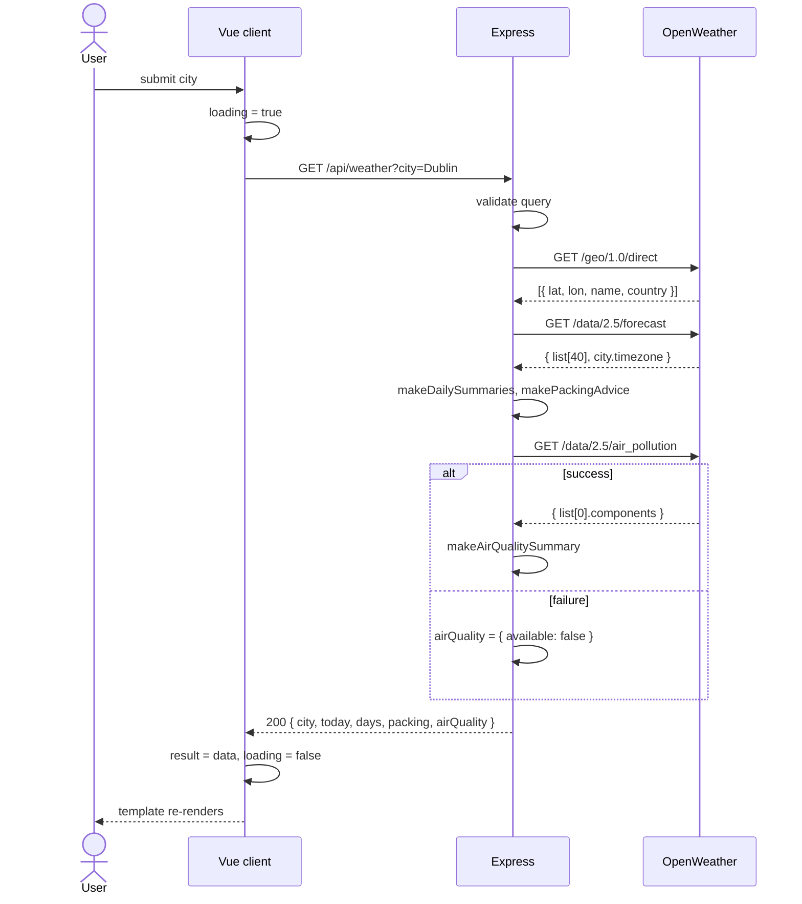

# Weather Planner

CSU44000 Internet Applications – Assignment 1
Liliana Berenguer Jin

---

## 1. Requirements

The app takes a city and shows the weather for the next three days, tells you whether to bring an umbrella, whether to pack for cold, mild or hot weather, and warns you if the air quality is bad. As an extra feature, it can compare two cities side by side.

The first thing I did was go through the brief and check which OpenWeather API could give me the data for each requirement (Table 1). Two things stood out. Geocoding has to be called first, because the other two APIs want coordinates, not a city name. And most of the requirements can be answered from the forecast response alone, so one call covers a lot.

**Table 1 – Requirements and the OpenWeather API used for each**

| Requirement | OpenWeather API | What it returns |
|---|---|---|
| City name → location | Geocoding (`/geo/1.0/direct`) | Latitude and longitude |
| Three-day forecast (temperature, wind, rain) | 5-day / 3-hour Forecast (`/data/2.5/forecast`) | About 40 readings, one every 3 hours |
| Umbrella and Cold / Mild / Hot advice | Forecast (same response) | Rain and temperature per reading |
| Pollutant warnings | Air Pollution (`/data/2.5/air_pollution`) | AQI (1–5) and the concentration of each pollutant |
| Compare two cities (extra) | All of the above, twice | Two summaries plus a comparison |

The brief also says the OpenWeather calls must be made from the server. This is because of the same-origin policy: a page served from `localhost:3000` cannot `fetch` from `api.openweathermap.org`. It also means the API key stays on the server instead of being visible in the browser.

---

## 2. System architecture

**Figure 1 – System architecture**

Some relevant points:

- The Express server does two things. It serves the static files (`index.html`, `app.js`, CSS) with `express.static`, and it has two routes, `/api/weather` and `/api/compare`, that call OpenWeather and reply with JSON.
- The page and the API come from the same origin, so there is no CORS setup at all.
- Both routes use `GET`, so calling them twice is safe and gives the same result. The server is stateless: no sessions, no database. Each request has everything it needs in the URL. I did this because it was simpler, but it also made the API easy to test by just typing the URL into the browser.
- The server does all the work. It sends back an already processed object (`today`, `days`, `packing`, `airQuality`) and the client only displays it. The rules live in one place and the client stays simple.
- The stack is Node 22, Express 4 and Vue 3 from a CDN. Node 22 has `fetch` built in and reads `.env` with `--env-file`, so Express is the only dependency.

---

## 3. Design process

I built the server in three iterations. I found this useful because it split the problem into smaller questions: first, can I get data out of OpenWeather at all; then, what do I do with it; and finally, what breaks when I try it with real cities. The client took two iterations.

### 3.1 Server

**Iteration 1 – just getting the data.** The first version only fetched and returned. It reads the city from the query string, calls Geocoding, takes the first result, calls Forecast with its `lat` and `lon`, and returns the raw readings. No validation, no error handling, around eighty lines. What I wanted from this step:

- Get `async/await` working with two calls that depend on each other. `fetch` runs outside the JavaScript engine as a Web API, and `await` hands control back to the event loop until the reply arrives. So even though Node is single-threaded, the server is not blocked while it waits.
- See what the data actually looks like. This is where I noticed that timestamps are in UTC, that `rain["3h"]` is only there when it rained, and that the forecast includes a `city.timezone` offset.

**Iteration 2 – processing the data.** This is where the core features got done:

- Group the readings into days and work out min, max and average temperature, average wind, total rain, and whether rain is expected.
- Apply the Cold / Mild / Hot thresholds from the brief to each day's average. If the days end up in different categories, the advice is "pack layers". Umbrella is set if any day expects rain.
- Add the Air Pollution call. Each pollutant is checked against the top of OpenWeather's "Good" range and anything above is reported with its level and a short health risk.
- Validate the input and return proper status codes (Table 2). A small `getOpenWeatherJson` helper wraps `fetch` and throws an error carrying a status when the network fails or OpenWeather replies with an error, so the route stays readable.

**Table 2 – Responses from `GET /api/weather`**

| Status | When |
|---|---|
| 200 | Success: `city`, `today`, `days[3]`, `packing`, `airQuality` |
| 400 | City missing or too long |
| 404 | Geocoding finds nothing |
| 500 | API key missing from `.env` |
| 502 | OpenWeather unreachable, returned an error, or returned too little data |

**Iteration 3 – fixing what real use showed.** Trying more cities and times of day exposed three problems:

- *The first day was wrong.* Searching in the evening gave a "day" with one or two readings, and for Tokyo the grouping landed on the wrong date because I was using UTC. Now each reading is shifted by `city.timezone` before taking its date, the current partial day is shown on its own as "today", and the table shows the next three full days.
- *One failing API broke the whole page.* If Air Pollution returned an error, the forecast disappeared too. That call now has its own `try/catch` and returns `{ available: false }` on failure, so the forecast still shows with a note.
- *The route was too big.* Everything was inside one `app.get`. I moved the logic into `getWeatherForCity(city)`, which throws errors with a status and a message that the route just passes on. This is what made the comparison feature easy to add later.

**Figure 2 – What happens during one search**

### 3.2 Client

**Iteration 1 – show the JSON.** One input, one button, and the raw response in a `<pre>` tag. Just enough to prove the round trip worked: `v-model` on the input, a method that calls `fetch`, and `{{ result }}` in the template.

**Iteration 2 – a proper interface.** The final client keeps that skeleton but the whole page is driven by a few reactive variables: `city`, `loading`, `result` and `error`. The template says what each state looks like and Vue updates the DOM when the variables change. I never touch the DOM myself. This is the MVVM idea Vue is based on: the template is the view, the Vue instance with its data, computed properties and methods is the view-model, and the server's JSON is the model. Compared with the old `XMLHttpRequest` way of finding an element and setting its `innerHTML`, it removes a whole category of bugs where the page and the data disagree.

**Table 3 – Vue features used**

| Feature | Used for |
|---|---|
| `v-model.trim` | Two-way binding on both city inputs |
| `@submit.prevent` | Run the search without reloading the page |
| `:disabled` | Block buttons while a request is running |
| `v-if` / `v-else-if` / `v-else` | Loading, error, empty and result panels |
| `v-for` with `:key` | Forecast rows, pollutant warnings, comparison cards |
| `:class` | Colour badges for Cold / Mild / Hot, umbrella, AQI, "better forecast" |
| `{{ }}` | All text output |
| `computed` | `cityLabel` from city, state and country |
| `methods` | Fetch calls and formatting helpers |

`searchWeather` calls `fetch` inside `try / catch / finally`, so `loading` is always reset. A shared `readJsonResponse` helper parses the reply and throws the server's error message if the status is not OK, so the search and the comparison handle errors the same way, each showing the message with a Retry button.

For the layout, today is on the left and the forecast table, packing advice and air quality are on the right. Weather icons come from an SVG sprite mapped from OpenWeather's icon codes. On small screens the table turns into stacked cards.

**Figure 3 – Result for Dublin** *(screenshot)*

### 3.3 Iteration 3 – comparing two cities

After loading a city, you can type a second one and see both forecasts side by side with a short verdict: which has the better weather, which needs an umbrella, which has worse air. I picked this because choosing between places is the actual reason someone would use the app, and it needed real work on both sides.

- **Server.** A new route, `GET /api/compare?cities=A&cities=B`. It takes repeated parameters so names with country codes ("Dublin, IE") are not split on the comma. It runs `getWeatherForCity` for both cities with `Promise.all`, so the two lookups happen at the same time instead of one after the other. `makeCityComparison` then ranks them: fewer rainy days wins, more Mild days breaks a tie, and the worse AQI is flagged. The verdict text is built on the server so the wording is consistent.
- **Client.** A second form bound to `comparisonCity`, with its own `comparing` and `comparisonError` state so it does not interfere with the main search, and a `v-for` over the two results rendering a card each. The winner is highlighted with `:class`.

**Figure 4 – Dublin compared with Lisbon** *(screenshot)*

---

## 4. Testing, limitations and future work

I tested by hand with a checklist: a normal city (Dublin, IE), an ambiguous one (Paris vs Paris, US), a made-up city, a missing API key, the Air Pollution URL broken on purpose, Tokyo to check the day grouping, and a comparison where one city is invalid to check the 404 comes through cleanly. Because the API is stateless, I could also test the server on its own from the address bar.

Limitations: only the first Geocoding match is used, the air quality is the current reading rather than a forecast, and the comparison ranking is a simple rule. Next steps would be deploying the server on AWS so it does not need to run locally, and caching OpenWeather responses for a few minutes, since a comparison currently costs six upstream calls.

What I mainly took from this is that most of the work in an app like this is on the server, turning someone else's data into exactly what the page needs, and that the client gets much simpler once the UI is just a function of its state.

---

**Appendix A – Source code** · **Appendix B – Academic integrity declaration**
