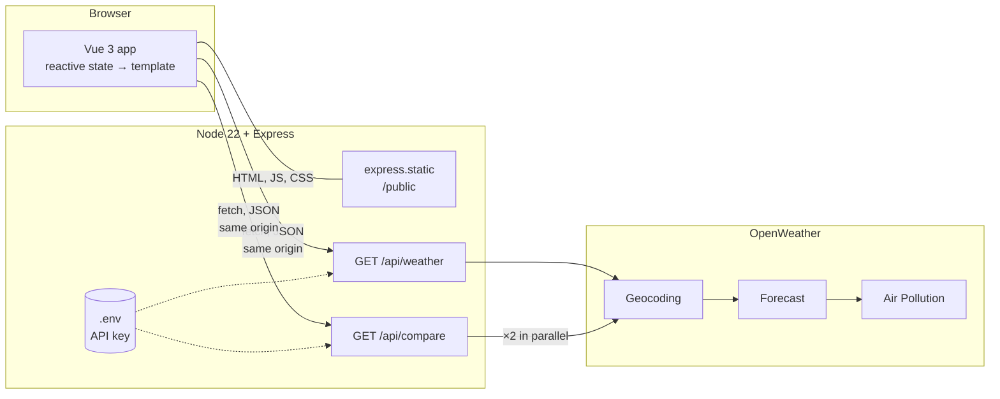
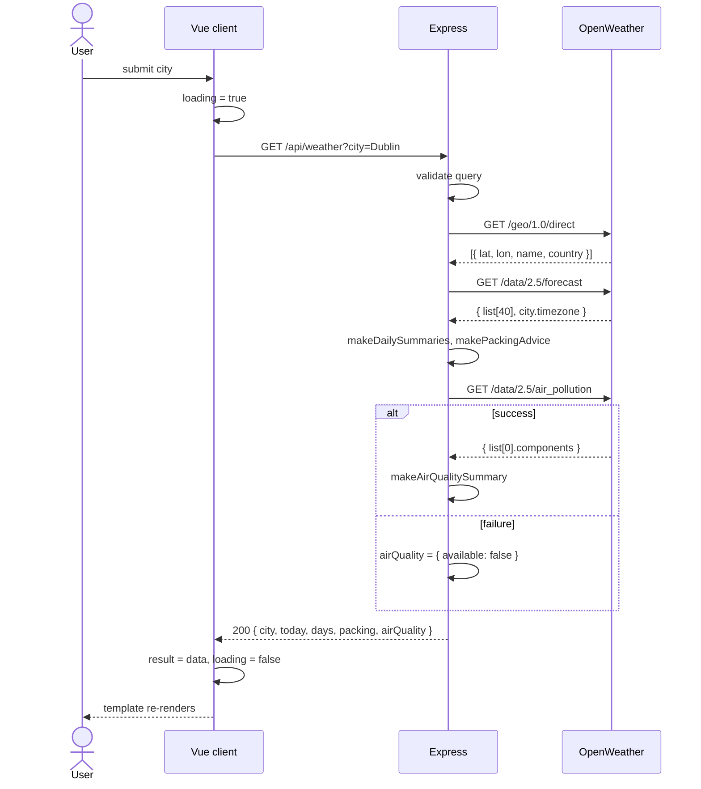

# Weather Planner

CSU44000 Internet Applications – Assignment 1
Liliana Berenguer Jin

---

## 1. Introduction

The app is a trip planner. You type the city you are going to and it shows the weather for the next three days, tells you whether to bring an umbrella and whether to pack for cold, mild or hot weather, and warns you if the air quality is bad. As an extra feature you can enter a second city and compare the two side by side.

It is a Vue 3 page in the browser talking to a Node.js / Express server, which gets its data from three OpenWeather APIs. There is no database and no login. Every search is a fresh request, and all the work of turning OpenWeather's data into something useful happens on the server.

**Figure 1 – Result for Dublin** *(screenshot)*

---

## 2. Design

### 2.1 Architecture

**Figure 2 – System architecture**

The browser never calls OpenWeather itself. It can't, because of the same-origin policy: a page served from `localhost:3000` is not allowed to `fetch` from `api.openweathermap.org`. So Express sits in the middle. It serves the page files from `/public` with `express.static`, and it has two routes, `/api/weather` and `/api/compare`, that make the OpenWeather calls and reply with JSON. The API key is read from a `.env` file on the server and never reaches the browser. Because the page and the API come from the same place, there is no CORS setup at all.

I kept the client thin on purpose. The server sends back an already processed object and the browser only displays it, so the rules live in one place. Both routes are plain `GET` requests with everything they need in the URL, which makes the server stateless. That was the simplest thing to do, and it also meant I could test the API by typing URLs straight into the address bar.

The stack is small: Node 22, Express 4, and Vue 3 from a CDN. Node 22 has `fetch` built in and loads `.env` with `--env-file`, so Express is the only dependency.

### 2.2 Which OpenWeather APIs

Before writing anything I went through the brief and matched each requirement to the API that could provide the data (Table 1). Geocoding has to go first, since the other two want coordinates rather than a city name, and most of the requirements can be answered from the forecast response alone.

**Table 1 – Requirements and the OpenWeather API used for each**

| Requirement | OpenWeather API | What it returns |
|---|---|---|
| City name → location | Geocoding (`/geo/1.0/direct`) | Latitude and longitude |
| Three-day forecast (temperature, wind, rain) | 5-day / 3-hour Forecast (`/data/2.5/forecast`) | About 40 readings, one every 3 hours |
| Umbrella and Cold / Mild / Hot advice | Forecast (same response) | Rain and temperature per reading |
| Pollutant warnings | Air Pollution (`/data/2.5/air_pollution`) | AQI (1–5) and the concentration of each pollutant |
| Compare two cities (extra) | All of the above, twice | Two summaries plus a comparison |

### 2.3 One search end to end

**Figure 3 – Sequence of one search**

Vue keeps the input in a `city` variable. Submitting the form calls `fetch("/api/weather?city=Dublin")`. The server checks the city, then calls OpenWeather three times in order: Geocoding for the coordinates, Forecast for the 3-hourly readings, and Air Pollution for the current air quality. It groups the readings into days, works out the packing advice and pollutant warnings, and sends back one object: `{ city, today, days, packing, airQuality }`. Vue stores that in `result` and the page updates itself, because the template is bound to it.

---

## 3. Server

I built the server in three steps, which split the problem into smaller questions: can I get data out of OpenWeather at all, what do I do with it, and what breaks with real cities.

**Step 1 – just get the data.** Call Geocoding, call Forecast with the coordinates, return the raw readings. No validation, no error handling. The point was getting `async/await` right with two calls that depend on each other. `fetch` is a Web API that runs outside the JavaScript engine; `await` hands control back to the event loop until the reply arrives, so the single-threaded server is not blocked while it waits. Seeing the raw data also showed me what I was dealing with: timestamps in UTC, `rain["3h"]` only present when it rained, and a `city.timezone` offset I had not noticed in the docs.

**Step 2 – process it.** This is where the core features got done. `makeDailySummaries` groups the readings by date and works out min, max and average temperature, average wind, total rain, and whether rain is expected. `makePackingAdvice` applies the Cold / Mild / Hot thresholds from the brief to each day's average, and says "pack layers" if the days land in different categories. The Air Pollution call was added, with `makeAirQualitySummary` checking each pollutant against the top of OpenWeather's "Good" range. And the route started validating input and returning proper status codes (Table 2). A small `getOpenWeatherJson` helper wraps `fetch` and throws an error carrying a status when the network fails or OpenWeather replies with an error, so the route handler stays short.

**Table 2 – Responses from `GET /api/weather`**

| Status | When |
|---|---|
| 200 | Success: `city`, `today`, `days[3]`, `packing`, `airQuality` |
| 400 | City missing or too long |
| 404 | Geocoding finds nothing |
| 500 | API key missing from `.env` |
| 502 | OpenWeather unreachable, returned an error, or returned too little data |

**Step 3 – fix what real use showed.** Trying more cities and times of day turned up three problems:

- *The first day was wrong.* Searching in the evening gave a "day" with one or two readings, and for Tokyo the grouping landed on the wrong date because I was using UTC. Now each reading is shifted by `city.timezone` before taking its date, the current partial day is shown on its own as "today", and the table shows the next three full days.
- *One failing API broke the whole page.* If Air Pollution errored, the forecast disappeared too. That call now sits in its own `try/catch` and returns `{ available: false }` on failure, so the forecast still shows with a note.
- *The route was too big.* Everything was inside one `app.get`. I moved the lookup into `getWeatherForCity(city)`, which throws errors with a status and a message that the route just passes on. That turned out to be what made the comparison feature cheap to add.

---

## 4. Client

The first client was one input, one button and the raw JSON in a `<pre>` tag, just to prove the round trip worked. The real one keeps that skeleton but drives the whole page from a few reactive variables: `city`, `loading`, `result` and `error`. The template says what each state looks like and Vue updates the DOM when they change. I never touch the DOM myself, which is the biggest difference from the old `XMLHttpRequest` way of finding an element and setting its `innerHTML`.

**Table 3 – Vue features used**

| Feature | Used for |
|---|---|
| `v-model.trim` | Two-way binding on both city inputs |
| `@submit.prevent` | Run the search without reloading the page |
| `:disabled` | Block buttons while a request is running |
| `v-if` / `v-else-if` / `v-else` | Loading, error, empty and result panels |
| `v-for` with `:key` | Forecast rows, pollutant warnings, comparison cards |
| `:class` | Colour badges for Cold / Mild / Hot, umbrella, AQI, "better forecast" |
| `{{ }}` | All text output |
| `computed` | `cityLabel` from city, state and country |
| `methods` | Fetch calls and formatting helpers |

`searchWeather` calls `fetch` inside `try / catch / finally` so `loading` is always reset. A shared `readJsonResponse` helper parses the reply and throws the server's error message if the status is not OK, so both the search and the comparison show errors the same way, with a Retry button.

For the layout, today is on the left and the forecast table, packing advice and air quality on the right. Icons come from an SVG sprite mapped from OpenWeather's icon codes, and on small screens the table turns into stacked cards.

---

## 5. Extra feature: comparing two cities

After loading a city you can type a second one and get both forecasts side by side with a verdict: which has the better weather, which needs an umbrella, which has worse air. I chose this because deciding between places is the actual reason someone would open the app, and it needed real work on both sides.

On the server there is a new route, `GET /api/compare?cities=A&cities=B`. It takes repeated parameters so names with country codes ("Dublin, IE") are not split on the comma. It runs `getWeatherForCity` for both cities with `Promise.all`, so the two lookups happen at the same time rather than one after the other. `makeCityComparison` then ranks them: fewer rainy days wins, more Mild days breaks a tie, and the worse AQI is flagged. The verdict sentence is built on the server so the wording stays consistent.

On the client there is a second form bound to `comparisonCity`, with its own `comparing` and `comparisonError` state so it does not interfere with the main search, and a `v-for` over the two results rendering a card each, with the winner highlighted through `:class`.

**Figure 4 – Dublin compared with Lisbon** *(screenshot)*

---

## 6. Testing and next steps

I tested by hand with a checklist: a normal city (Dublin, IE), an ambiguous one (Paris vs Paris, US), a made-up city, a missing API key, the Air Pollution URL broken on purpose, Tokyo for the day grouping, and a comparison with one invalid city to check the 404 comes through cleanly.

Known limitations: only the first Geocoding match is used, air quality is the current reading rather than a forecast, and the comparison ranking is a simple rule. Next steps would be deploying the server on AWS so it does not have to run locally, and caching OpenWeather responses for a few minutes, since a comparison currently costs six upstream calls.

---

**Appendix A – Source code** · **Appendix B – Academic integrity declaration**
