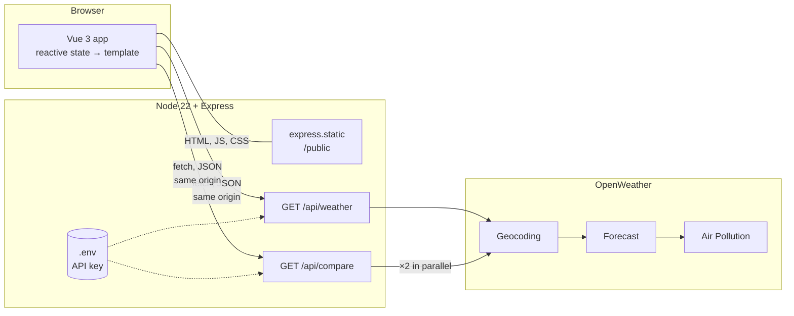
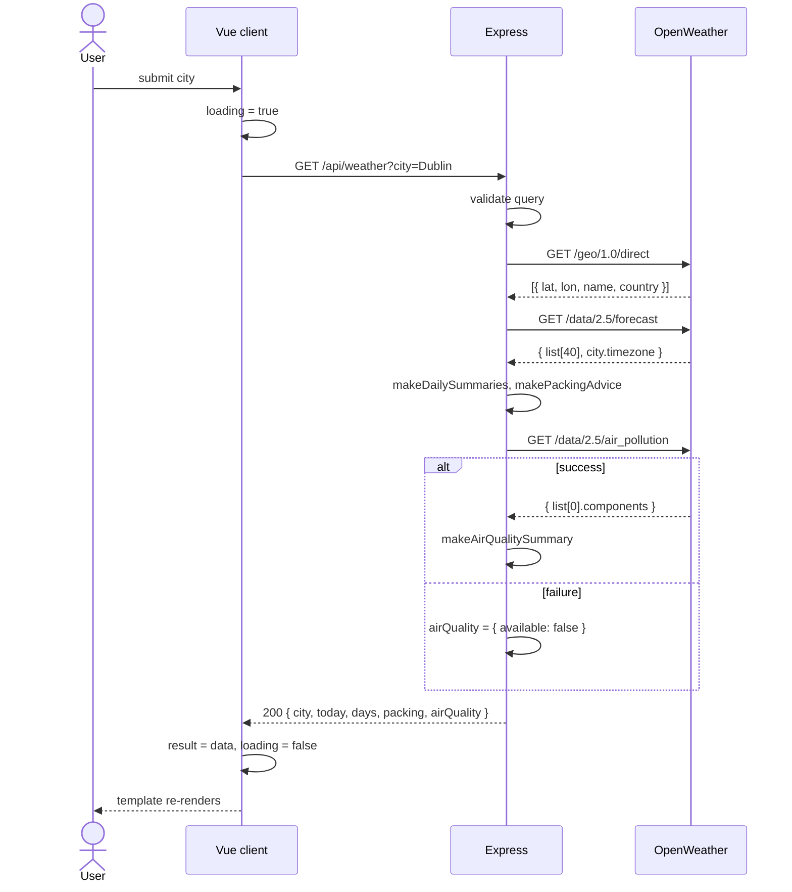

# Daymark: a reactive weather and packing planner

CSU44000 Internet Applications – Assignment 1
Liliana Berenguer Jin

---

## 1. Requirements

The application takes a destination city and returns a three-day forecast, packing advice (umbrella, and whether to dress for cold, mild or hot weather) and an air-quality warning if any pollutant is above OpenWeather's "Good" band. As the extra feature, it can compare two destinations side by side.

Before writing code I mapped each requirement to the OpenWeather endpoint that could satisfy it (Table 1). This settled two things early. Geocoding has to run first, because the forecast and air-pollution endpoints take coordinates rather than a city name. And three of the four core requirements come out of the same forecast response, so one request can feed most of the page.

**Table 1 – Requirements mapped to OpenWeather APIs**

| Requirement | OpenWeather API | What it returns |
|---|---|---|
| City name → location | Geocoding (`/geo/1.0/direct`) | Latitude and longitude |
| Three-day forecast (temperature, wind, rain) | 5-day / 3-hour Forecast (`/data/2.5/forecast`) | ~40 readings at 3-hour intervals |
| Umbrella and Cold / Mild / Hot advice | Forecast (same response) | Rain and temperature per reading |
| Pollutant warnings with health risk | Air Pollution (`/data/2.5/air_pollution`) | AQI (1–5) and concentrations of SO₂, NO₂, PM₁₀, PM₂.₅, O₃, CO |
| Compare two cities (extra feature) | All of the above, twice | Two summaries plus a comparison |

The brief also fixes the shape of the system: a Vue client in the browser, a Node server exposing at least one API primitive, and the third-party calls made from the server. That last point is not optional. `fetch` in the browser is subject to the same-origin policy, so a page served from `localhost:3000` cannot call `api.openweathermap.org`, and the API key would be visible in the developer tools anyway.

---

## 2. System architecture

**Figure 1 – System architecture**

Relevant points:

- **Two jobs for Express.** `express.static` serves `index.html`, `app.js` and the stylesheet from `/public`; two `app.get` routes read `req.query`, call OpenWeather and reply with `res.json`. Because the page and the API share an origin there is no CORS configuration at all.
- **REST-style endpoints.** Each URI identifies a resource (the packing summary for a city, or a comparison of two). Both are read with `GET`, so repeating a request is safe and idempotent, and the server is stateless: no sessions, no database, every request carries everything it needs. I chose that for simplicity, but it is also what makes the API testable from the browser address bar and what would let it scale horizontally later.
- **Thin client.** The server returns an already-digested object (`today`, `days`, `packing`, `airQuality`) and the browser only renders it. The business rules live in one place and are never exposed to the client.
- **Minimal stack.** Node 22, Express 4 and Vue 3 from a CDN with no build step. Node 22 has `fetch` built in and reads `.env` with `--env-file`, so Express is the only dependency.

---

## 3. Design process

I built the server in three iterations, which I thought would be useful for separating three different questions: how to talk to OpenWeather, what to do with its data, and what breaks once real users and real cities are involved. The client went through two.

### 3.1 Server

**Iteration 1 – retrieving the responses.** The first version only fetched and returned. It reads the city from the query string, builds the Geocoding URL with `URLSearchParams`, `await`s the reply, takes the first match, builds the Forecast URL from its `lat` and `lon`, `await`s again, and returns the readings as `{ time, temperature, description }`. About eighty lines, no validation, no error handling. The point was to get the asynchronous flow right before adding logic:

- `fetch` runs outside the JavaScript engine as a Web API. `await` suspends the handler and hands control back to the event loop; the handler resumes from the queue when the response arrives. Node is single-threaded, but the server is never blocked waiting for OpenWeather.
- Writing the two dependent calls with `async/await` rather than `.then()` chains keeps them readable top to bottom, which mattered once a third call was added.
- Returning raw readings let me see the actual shape of the data: UTC timestamps in `dt`, `main.temp`, `wind.speed`, `rain["3h"]` present only when it rained, and a `city.timezone` offset I had not noticed in the documentation.

**Iteration 2 – processing the responses.** This iteration added everything the brief asks for, and at the end of it the core features were met:

- `makeThreeDaySummary` groups the readings by date and computes min, max and average temperature, average wind, total rainfall from `rain.3h`, and a `rainExpected` flag set if any reading reports rain or a Rain / Drizzle / Thunderstorm condition.
- The Cold / Mild / Hot thresholds are applied to each day's average. If the days fall into different categories the advice is "pack layers". Umbrella is set if any day expects rain.
- The Air Pollution call was added as a third step. Each pollutant is compared with the top of OpenWeather's "Good" band and anything above is reported with its band and a short health risk.
- Input validation and HTTP status codes (Table 2). A `getOpenWeatherJson` wrapper turns network failures and non-2xx replies into errors carrying a status, so the route handler stays readable.

**Table 2 – Responses from `GET /api/weather`**

| Status | When |
|---|---|
| 200 | Success: `city`, `today`, `days[3]`, `packing`, `airQuality` |
| 400 | City missing or over 100 characters |
| 404 | Geocoding finds no match |
| 401 / 429 | Passed through from OpenWeather (bad key / rate limit) |
| 502 | OpenWeather unreachable or returned no readings |

**Iteration 3 – refining.** Testing iteration 2 with more cities showed three problems, each of which changed the code:

- *The first day was wrong.* Searching late in the evening gave a "day" with one or two readings, and for Tokyo the grouping landed on the wrong date entirely because I was grouping by UTC. I now shift each reading by `city.timezone` before taking its date, show the current partial day separately as "today" in the sidebar, and fill the table with the next three full local days (`dailySummaries.slice(1, 4)`).
- *One failing API took down the whole page.* When the Air Pollution endpoint returned an error the user lost the forecast too. That call now sits in its own `try/catch` and returns `{ available: false, message }` on failure, so the forecast still renders with a note.
- *The route handler was doing too much.* Everything lived inside `app.get`. I extracted `getWeatherForCity(city, apiKey)`, which throws errors tagged with a status and a client-facing message, and `sendApiError` to translate them. This was what later made the comparison feature a small change rather than a copy-paste.

**Figure 2 – Sequence of one search (final server)**

### 3.2 Client

**Iteration 1 – rendering the JSON.** The first client was one `<input>`, one button, and a `<pre>` showing the raw response. It existed to prove the round trip: `v-model` on the input, a method calling `fetch` with `encodeURIComponent(city)`, and `{{ result }}` in the template.

**Iteration 2 – a state-driven interface.** The real client keeps the same skeleton but treats the whole page as a function of a few reactive variables. The client follows Vue's MVVM-style split: the template is the view, the Vue instance with its reactive `data()`, `computed` properties and `methods` is the view-model, and the server's JSON is the model. I never manipulate the DOM; the template declares what each state looks like and Vue's virtual DOM works out what to re-render. Compared with the `XMLHttpRequest` style of finding an element and setting `innerHTML`, this removed the whole class of bugs where the page and the data disagree.

**Table 3 – Vue features used**

| Feature | Used for |
|---|---|
| `v-model.trim` | Two-way binding of both city inputs |
| `@submit.prevent` | Run `searchWeather()` / `compareCities()` without a page reload |
| `:disabled` | Block buttons while `loading` or `comparing` |
| `v-if` / `v-else-if` / `v-else` | Loading, error, empty and result panels; air-quality states; comparison states |
| `v-for` with `:key` | Forecast rows, pollutant warnings, the two comparison cards |
| `:class` | Colour badges for Cold / Mild / Hot, umbrella advice, AQI dot, "better forecast" label |
| `{{ }}` | All text output |
| `computed` | `cityLabel` from city, state and country |
| `methods` | Fetch calls and formatting helpers |

`searchWeather` is an `async` method using the Fetch API inside `try / catch / finally`, so `loading` is always reset. A non-OK response puts the server's error message in a panel with a Retry button. One refinement came from a confusing bug: opening the page through a different local server returned HTML instead of JSON and `response.json()` failed with an unhelpful message. `readJsonResponse` now checks the `Content-Type` header first and explains what went wrong.

Visually it is a two-panel layout: today on the left, the forecast table with packing and air-quality cards on the right, an SVG icon sprite mapped from OpenWeather's icon codes, and colour-coded badges. On narrow screens the table collapses into stacked cards.

**Figure 3 – Result view for Dublin** *(screenshot)*

### 3.3 Iteration 3 – comparing two destinations

Once a city is loaded, the user can enter a second one and get both forecasts side by side with a short verdict: which has the better forecast, which needs an umbrella, which has worse air. It is the question the app is really for, deciding between places, and it needed non-trivial work on both sides.

- **Server.** A second primitive, `GET /api/compare?cities=A&cities=B`. It accepts repeated parameters so that country codes containing commas ("Dublin, IE") survive, and runs `getWeatherForCity` for both cities with `Promise.all`, so the two three-call chains run concurrently instead of one after the other. `makeCityComparison` then ranks the cities: fewer rain days wins, with more Mild days as the tie-break, and flags the worse AQI. The verdict is built on the server so the wording is consistent and the client stays dumb.
- **Client.** A second form bound to `comparisonCity`, its own `comparing` and `comparisonError` state so it never interferes with the main search, and a `v-for` over the two destinations rendering a card each, with the winner highlighted through `:class` on `betterWeatherIndex`.

**Figure 4 – Comparison of Dublin and Lisbon** *(screenshot)*

---

## 4. Testing, limitations and future work

I tested manually against a checklist: a known city (Dublin, IE), an ambiguous one (Paris vs Paris, US), a made-up city, a missing API key, the air-pollution URL broken on purpose, Tokyo for the local-date grouping, and comparisons where one city is invalid to confirm `Promise.all` fails cleanly with the 404 message. The stateless API also meant I could test the server on its own from the browser address bar.

Known limitations: only the first Geocoding match is used, the air-quality reading is current rather than forecast, and the comparison ranking is a simple heuristic. The obvious next step is deploying the server on AWS so the app does not have to run locally, and caching OpenWeather responses for a few minutes so a comparison does not cost six upstream calls.

The main thing I took from this is how much of an Internet application is the server reshaping third-party data into exactly what the client needs, and how much simpler the client becomes once the UI is a function of state rather than a sequence of DOM edits.

---

**Appendix A – Source code** · **Appendix B – Academic integrity declaration**
