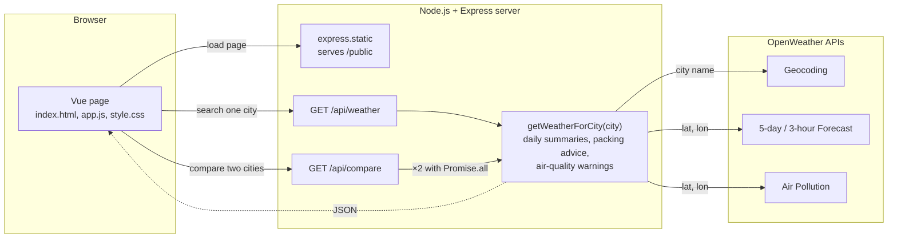
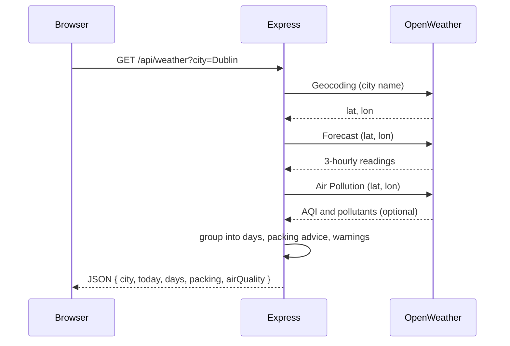

# Weather Planner

CSU44000 Internet Applications – Assignment 1
Liliana Berenguer Jin

---

## 1. Requirements

Weather Planner is a small reactive Internet Application that takes a destination city and tells the traveller what to pack. The client runs in the browser using Vue 3. It talks to a Node.js / Express server, which does the actual work: it calls OpenWeather, reduces what comes back into a short summary, and returns that as one JSON object for the page to display. The calls to OpenWeather have to live on the server because of the browser's same-origin policy, and it keeps the API key out of the client anyway.

Before writing any code, I listed the core requirements from the assignment and matched each one to the OpenWeather API that could provide the data. This gave me a starting point for how to structure the server and, more importantly, what the client would never need to know about. Table 1 is what I ended up with.

**Table 1 – Requirements and the OpenWeather API used for each**

| Requirement | OpenWeather API | What it provides |
|---|---|---|
| Turn the city name into a location | Geocoding (`/geo/1.0/direct`) | Latitude and longitude |
| Three-day table of temperature, wind speed and rainfall | 5-day / 3-hour Forecast (`/data/2.5/forecast`) | Around 40 readings at three-hour intervals |
| Umbrella if rain is forecast; Cold / Mild / Hot packing advice (below 8 °C, 8–24 °C, above 24 °C) | Forecast (same response) | Rain and temperature per reading |
| Warning for each pollutant above the "Good" level, with its level and health risk | Air Pollution (`/data/2.5/air_pollution`) | AQI (1–5) and the concentration of each pollutant |
| Compare two cities side by side (extra feature) | All of the above, twice | Two summaries plus a verdict |

One thing the table made obvious is the order of the requests: Geocoding has to go first, since the other two APIs want coordinates rather than a name.

---

## 2. System architecture

**Figure 1 – System architecture.** The browser loads the page from Express and then sends it a city through one of the two routes. Express calls `getWeatherForCity`, which asks OpenWeather for the location, the forecast and the air quality, builds the summary, and returns it to the browser as JSON. For a comparison the same function runs twice.

Some main observations:

- The route handlers only deal with HTTP. They read and validate the query string and turn errors into status codes. Everything else happens in `getWeatherForCity`, which fetches and processes the data for one city. Both routes call it, so when I added the comparison feature I did not have to duplicate the lookup. The helpers below it (`makeDailySummaries`, `makePackingAdvice`, `makeAirQualitySummary`) contain the rules and have no idea they are inside a web server.
- The server is stateless. Both routes are plain `GET` requests, there are no sessions and nothing is stored between calls, so the same request always gives the same answer. This was the simplest option and it also made the server easy to test on its own, by opening the route in the browser with a city in the URL.
- The client follows the MVC paradigm: the JSON from the server is the model, the HTML template is the view, and the Vue instance holding the data and methods is the controller. There is no manual DOM manipulation: the template describes what each state should look like and Vue updates the DOM when the data changes.
- I kept dependencies to a minimum. Node 22 already has `fetch` and can load `.env` itself, and Vue comes from a CDN, so the project only installs Express and nothing needs to be built before running it.

---

## 3. Design process

I found myself building the server in three iterations, each one answering a different question: first, can I get anything out of OpenWeather at all; then, what do I do with what comes back; and finally, what goes wrong once I try it with real cities. The client went through two.

### 3.1 Server

**Iteration 1:** the first version just called the Geocoding and Forecast APIs and passed the response straight through. It took the city from the query string, called Geocoding to get the coordinates, called Forecast with them, and returned the raw readings exactly as OpenWeather sent them, with nothing processed and no error handling. Two things came out of this:

- Getting `async/await` right with two requests where the second depends on the first. `fetch` returns a promise, and while the server waits for OpenWeather to reply, `await` lets the event loop carry on handling other requests instead of blocking on the one thread Node has.
- Understanding the Forecast response. OpenWeather does not return "days"; it returns a `list` of about forty entries, one every three hours, each with its own `main.temp`, `wind.speed` and `rain` values. So to show three days I would have to group those entries myself. Looking through them also showed that the timestamps are in UTC, that `rain["3h"]` is missing when it did not rain, and that the response includes a `city.timezone` offset. These were the motivations for what to do with the response in iteration 2.

**Iteration 2:** this is where the core features got mostly done:

- The three-hourly entries in `list` are grouped by date, and for each day the server computes the min, max and average of `main.temp`, the average `wind.speed`, the total `rain["3h"]` and whether rain is expected.
- The Cold / Mild / Hot thresholds from the brief are applied to each day's average. If the three days fall into different categories the advice becomes "pack layers". The umbrella flag, on the other hand, is set if any day expects rain.
- The Air Pollution call was added. Each pollutant is compared with the upper limit of OpenWeather's "Good" band, and anything above it is reported with its band and a short health risk.
- The route now validates the city it receives from the client and replies with a proper HTTP status code when something goes wrong (Table 2), so the client can show a sensible message instead of a generic failure. A small `getOpenWeatherJson` helper wraps `fetch` and throws an error carrying a status when the network fails or OpenWeather replies with an error, which keeps the route handler readable.

| Status | Condition |
|---|---|
| 200 (OK) | Success: `city`, `today`, `days[3]`, `packing`, `airQuality` |
| 400 (Bad Request) | City missing or over 100 characters |
| 404 (Not Found) | Geocoding returns no match |
| 500 (Internal Server Error) | API key missing from `.env` |
| 502 (Bad Gateway) | OpenWeather unreachable, returned an error, or returned too little data |

**Table 2 – Status codes returned by `GET /api/weather`.** I picked them from the standard list of HTTP status codes: 4xx when the problem is with the request (the client can fix it), 5xx when it is on the server side. 502 is the one for "the upstream service failed", which is exactly the OpenWeather case.

**Iteration 3:** with the core features in place I started trying the app with more cities and at different times of day, and three things needed changing:

- The grouping into days was done on UTC dates, so for a city like Tokyo the first "day" could be the wrong date, and searching in the evening gave a first day with only one or two entries. I now shift each entry by `city.timezone` before taking its date, show the current partial day on its own as "today", and fill the table with the next three full local days.
- If the Air Pollution request failed, the whole response failed with it and the user lost the forecast as well. That call now has its own `try/catch` and returns `{ available: false }` on failure, so the forecast still renders with a note saying air quality is unavailable.
- The route handler had grown into one long `app.get` with everything inside it. I moved the lookup into `getWeatherForCity(city)`, which throws errors tagged with a status and a message, and the route only passes them on. This is what later made the comparison feature cheap to add.

Figure 2 summarises what the final server does for one search. The three OpenWeather calls run one after the other because each needs something from the previous one, and the air-quality call is the only one allowed to fail.

**Figure 2 – One search handled by the final server**

### 3.2 Client

The client started as a skeleton: one input bound with `v-model`, a button that called `fetch` on the server, and `{{ result }}` printing the raw JSON. Its only purpose was to prove the round trip worked. The final page keeps that skeleton and builds on it. The Vue instance holds a small amount of reactive state (`city`, `loading`, `result`, `error`, and the equivalent three for the comparison), and everything on screen is derived from it. The template uses `v-if` / `v-else` to switch between the loading, error, empty and result panels, `v-for` to render the forecast rows and pollutant warnings, `:class` to colour the Cold / Mild / Hot badges, and mustache syntax for all the text. There is no manual DOM manipulation anywhere; when `result` changes, Vue redraws the parts of the page that depend on it.

The methods are small. `searchWeather` and `compareCities` wrap their `fetch` calls in `try / catch / finally`, so the loading flag is always reset, and both go through a shared `readJsonResponse` helper that parses the reply and throws the server's error message if the status is not OK. That way the two searches show errors the same way, with the message and a Retry button. The rest of the methods are formatters for dates, temperatures and rainfall, and a lookup from OpenWeather's icon codes to the app's own icons.

For the layout, today's summary sits on the left and the forecast table, packing advice and air quality on the right. Weather icons come from an SVG sprite, and on narrow screens the table collapses into stacked cards.

**Figure 3 – Result view for Dublin** *(screenshot)*

### 3.3 Iteration 3 – comparing two destinations

Once a city is loaded, the user can enter a second one and see both forecasts side by side with a short verdict: which has the better weather, which needs an umbrella, and which has worse air. I chose this feature because deciding between places is the real reason someone would open the app, and it required non-trivial work on both sides.

- **Server.** A second route, `GET /api/compare?cities=A&cities=B`. It accepts repeated parameters so that names with country codes ("Dublin, IE") are not split on the comma. It runs `getWeatherForCity` for both cities with `Promise.all`, so the two lookups proceed concurrently rather than one after the other. `makeCityComparison` then ranks them: fewer rainy days wins, more Mild days breaks a tie, and the worse AQI is flagged. The verdict text is composed on the server so the wording stays consistent.
- **Client.** A second form bound to `comparisonCity`, with its own `comparing` and `comparisonError` state so it never interferes with the main search, and a `v-for` over the two results rendering a card each, with the winner highlighted through `:class`.

**Figure 4 – Dublin compared with Lisbon** *(screenshot)*

---

## 4. Testing, limitations and future work

I tested manually against a checklist: a known city (Dublin, IE), an ambiguous one (Paris vs Paris, US), a made-up city, a missing API key, the Air Pollution URL deliberately broken, Tokyo for the local-date grouping, and a comparison with one invalid city to confirm the 404 is reported cleanly. Because the API is stateless, I could also exercise the server on its own from the address bar.

Known limitations: only the first Geocoding match is used, air quality is the current reading rather than a forecast, and the comparison ranking is a simple heuristic. The natural next steps are deploying the server on AWS so the app no longer has to run locally, and caching OpenWeather responses for a few minutes, since a comparison currently costs six upstream calls.

What I mainly took from this assignment is that most of the work in an application like this happens on the server, reshaping someone else's data into exactly what the page needs, and that the client becomes much simpler once the UI is a function of its state.

---

**Appendix A – Source code** · **Appendix B – Academic integrity declaration**
